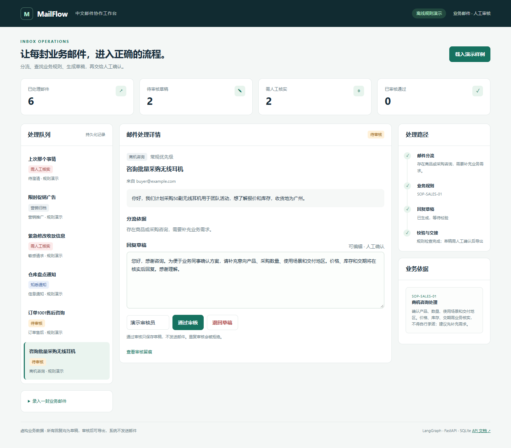
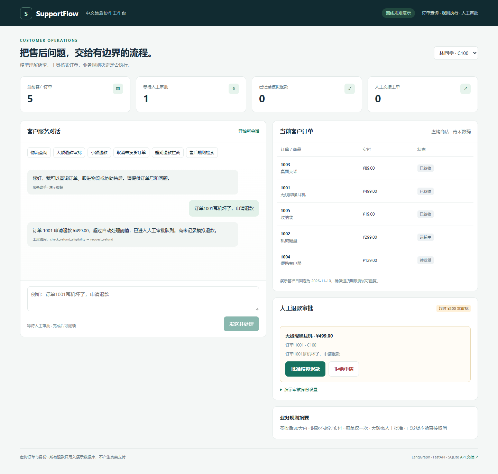

# AI 业务应用作品集

两个可以本地运行、查看处理依据并复现实验的中文业务应用：邮件分流与回复审核，以及电商售后与退款审批。

| 项目 | 业务流程 | 主要实现 | 本地验证 |
|---|---|---|---|
| [MailFlow CN](mailflow-cn/) | 咨询分流 → 规则匹配 → 草稿 → 人工审核 → 导出 | LangGraph、FastAPI、SQLite、中文工作台 | 22项检查；30条合成用例分流匹配28条 |
| [SupportFlow CN](supportflow-cn/) | 客户诉求 → 订单工具 → 规则校验 → 审批 → 模拟结果 | LangGraph、工具调用、人工中断、持久化、中文工作台 | 40项检查；12条离线场景通过 |

> 以上均为本地Python 3.12、离线规则模式下的结果；真实模型尚未验证。数据均为虚构，评测使用合成开发用例。项目采用开源二次开发与AI辅助实现，来源和改造边界在各项目文档中列明。

## 邮件分流与审核



每封邮件展示分流依据、SOP引用与步骤记录。生成的草稿由人工编辑、审核后导出；修改留痕、去重和审核版本检查可复现。保留两条规则误判，展示当前方案的局限。

- [项目说明与启动](mailflow-cn/README.md)
- [场景评测](mailflow-cn/artifacts/EVALUATION.md)
- [实现与演示讲解](mailflow-cn/docs/WALKTHROUGH.md)

## 电商售后与退款审批



通过订单工具获取事实，由业务代码检查退款期限、金额和客户归属。大额请求暂停等待人工审批，审批后恢复流程。订单状态与退款凭证重启后仍可恢复，所有支付均为模拟。

- [项目说明与启动](supportflow-cn/README.md)
- [场景评测](supportflow-cn/artifacts/EVALUATION.md)
- [实现与演示讲解](supportflow-cn/docs/WALKTHROUGH.md)

## 从这里运行

```powershell
git clone https://github.com/flghting1/llm-practice-AI.git
cd llm-practice-AI
# 选择一个项目进入，例如邮件项目：
cd mailflow-cn
python -m venv .venv
.\.venv\Scripts\python.exe -m pip install -r requirements-demo.txt
.\.venv\Scripts\python.exe run.py --mode offline
```

邮件界面：[127.0.0.1:8101](http://127.0.0.1:8101)。售后项目按同样步骤进入 `supportflow-cn`，界面在 [127.0.0.1:8102](http://127.0.0.1:8102)。Linux/macOS用 `.venv/bin/python` 替换解释器路径。

两个项目都支持在本机 `.env` 中配置兼容模型服务；需要模型支持结构化输出或工具调用。配置方式见各自README，当前材料只证明已记录的离线流程与本地浏览器验收。

## 工程证据与边界

- 合成业务样例、失败用例、测试代码、机器可读评测JSON和真实运行截图均随源码提供。
- 根目录CI配置覆盖两个项目；是否云端通过，以本仓库Actions实际记录为准。
- 默认仅监听本机，不含真实邮件发送、真实退款或生产认证。
- [开源来源与许可证](THIRD_PARTY_NOTICES.md)；[版本替换与备份说明](REPOSITORY_MIGRATION.md)。
