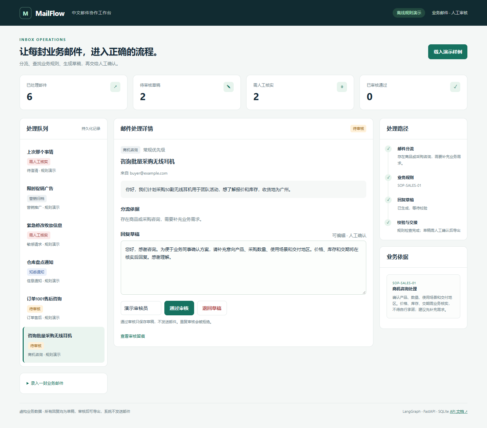
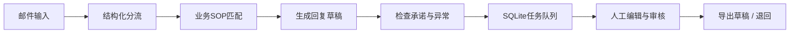

# MailFlow CN · 中文业务邮件协作工作台

将采购咨询、售后邮件、内部通知和敏感请求分流，依据业务 SOP 生成回复草稿，经人工编辑审核后导出，并保留处理和修改记录。



## 解决的问题

业务人员收到咨询邮件后，需要判断邮件类型、查找处理规范、撰写回复并确认是否可以对外使用。本项目把这些步骤放在同一条可检查的流程中：每封邮件展示分流依据、引用的 SOP、草稿和审核轨迹。



## 本次改造

基于 [LangChain Agents From Scratch](https://github.com/langchain-ai/agents-from-scratch) 的邮件分流、工具协作、评测和人工反馈思路，新增 `src/mailflow_cn/` 中文应用模块。上游源代码保留在 `src/email_assistant/`，许可证和基准提交见 [来源说明](docs/ORIGIN.md)。本次实现采用 AI 辅助开发。

- 中文商机、订单售后、信息通知、营销、风险及未知邮件分类。
- LangGraph 显式执行分流、规则匹配、起草和校验，界面展示各步依据。
- SQLite 保存任务、草稿和人工修改留痕；重复邮件去重，审核带版本检查。
- 草稿必须先审核，才能导出；风险请求不生成可执行回复。
- 支持无需密钥的规则演示与可配置的兼容 API 模型；模型失败显示人工处理状态。
- 中文网页、6条交互样例、30条合成评测用例、自动化测试和 CI 配置。

## 快速运行（Windows / Python 3.12）

从本仓库根目录执行：

```powershell
cd mailflow-cn
python -m venv .venv
.\.venv\Scripts\python.exe -m pip install -r requirements-demo.txt
.\.venv\Scripts\python.exe run.py --mode offline
```

打开 [http://127.0.0.1:8101](http://127.0.0.1:8101)，点击“载入演示样例”。无需激活环境，也无需模型密钥。macOS/Linux 将解释器路径改为 `.venv/bin/python`。

演示顺序：选择采购咨询 → 编辑草稿 → 通过审核 → 查看审核留痕 → 导出草稿；然后查看敏感请求的人工核实分流。系统不发送邮件。

## 配置真实模型

```powershell
Copy-Item .env.example .env
# 在本机编辑 .env，填入服务商的密钥、模型ID和兼容API地址。
.\.venv\Scripts\python.exe run.py --mode openai
```

`OPENAI_BASE_URL` 为可选兼容端点，`OPENAI_MODEL` 必须使用该服务商实际支持的模型ID。分流依赖结构化输出；按服务商能力设置 `LLM_STRUCTURED_METHOD`。密钥只放本机 `.env`，不放进网页或提交到仓库。当前发布材料尚未验证真实模型调用。

## 测试与实际证据

```powershell
.\.venv\Scripts\python.exe -m pytest portfolio_tests -q
.\.venv\Scripts\python.exe scripts/evaluate.py --provider offline
```

本地 Python 3.12 下通过22项自动化检查。30条合成开发用例中，离线规则分流匹配28条；库存告警、订单日报两条歧义用例保留为失败结果，见 [评测记录](artifacts/EVALUATION.md) 与 [原始JSON](artifacts/evaluation.json)。这是人工编写的开发用例，不是独立留出集，也不代表大模型准确率。

桌面和手机浏览器交互检查见 [UI验收记录](artifacts/ui-checks.json)。GitHub Actions 配置在根仓库；云端结果以 Actions 实际运行记录为准。

## 主要目录

| 路径 | 用途 |
|---|---|
| `src/mailflow_cn/flow.py` | 工作流、分流规则、模型调用和结果校验 |
| `src/mailflow_cn/storage.py` | SQLite、幂等去重和审核事件 |
| `src/mailflow_cn/api.py` | FastAPI接口、人工审核和导出 |
| `web/` | 中文工作台 |
| `portfolio_tests/` | 中文应用测试 |
| `data/` | 合成样例与评测数据 |
| `artifacts/` | 本地执行的评测和验收记录 |

## 当前边界

定位为本地作品演示：默认监听127.0.0.1，邮件与身份均为演示数据。未连接真实邮箱、未自动发信、未实现生产身份认证。关键词分流存在歧义；可通过真实模型和更丰富的独立数据集继续验证。上游课程测试、Gmail集成和记忆版本未纳入本次离线验收，相关源代码供参考。

更多说明见 [演示与实现讲解](docs/WALKTHROUGH.md)。
