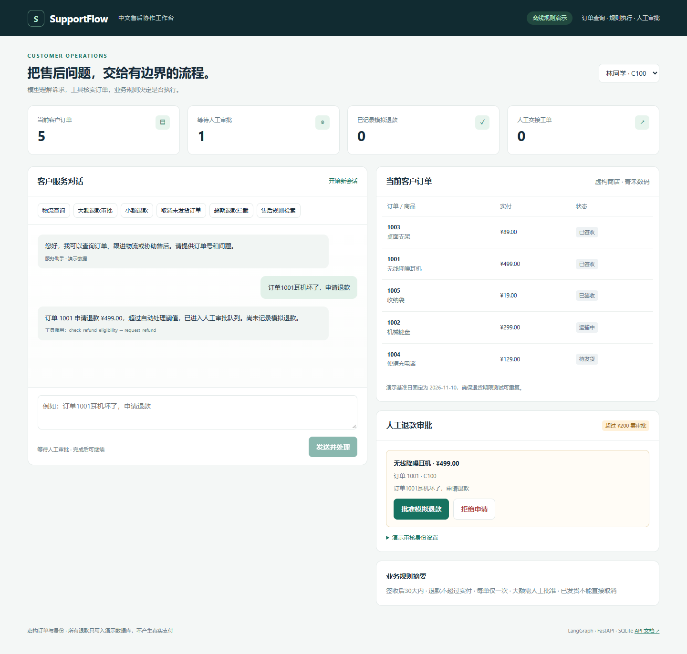
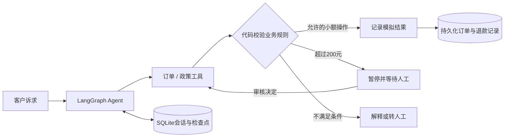

# SupportFlow CN · 中文电商售后协作工作台

围绕订单查询、物流、退货退款、取消订单和人工交接搭建售后 Agent。模型负责提出工具调用，业务代码负责检查规则，大额退款需要人工批准。



## 解决的问题

售后对话需要同时考虑客户身份、订单事实、退货期限和审批权限。把这些规则仅写在提示词里，无法可靠约束执行。本项目让请求经过真实的订单工具、明确的业务校验和人工审批，再记录模拟结果。



## 本次改造

基于 [LangGraph Support Agent](https://github.com/nitanandsinghupw/langgraph-support-agent)，保留上游工具、规则与审批架构，增加中文业务层。本次实现采用 AI 辅助开发，许可证与基准提交见 [来源说明](docs/ORIGIN.md)。

- 虚构“青禾数码”中文订单、客户和人民币业务场景，演示日期固定为2026-11-10。
- 中文意图识别、中文回复和政策检索；英文上游回归用例继续保留。
- 中文售后网页，包含客户切换、订单列表、对话、工具轨迹和审批队列。
- 订单状态、退款凭证和人工工单保存到SQLite，服务重启后仍保留，重复退款受唯一约束保护。
- 兼容模型端点可配置；保留离线规则模型，便于无密钥演示与回归测试。
- 中文业务检查、原始回归测试、12条独立场景运行记录和CI配置。

## 快速运行（Windows / Python 3.12）

从本仓库根目录执行：

```powershell
cd supportflow-cn
python -m venv .venv
.\.venv\Scripts\python.exe -m pip install -r requirements-demo.txt
.\.venv\Scripts\python.exe run.py --mode offline
```

打开 [http://127.0.0.1:8102](http://127.0.0.1:8102)。macOS/Linux 将解释器路径改为 `.venv/bin/python`。

建议先演示“大额退款审批”：提交订单1001售后 → 确认退款数仍为0 → 在右侧批准 → 检查模拟退款记录。然后用订单1003演示超期退款拦截，用订单1002演示物流查询。可点击“开始新会话”处理其他诉求。

## 演示业务规则

规则是项目配置，不代表真实商家条款或法律规定：签收后30天内、退款不超过实付、每单仅退款一次、超过200元需人工审批，只有未发货订单可以直接取消。订单、运单、客户与资金均为模拟，不连接真实支付。

## 配置真实模型

```powershell
Copy-Item .env.example .env
# 填入服务商的密钥、模型ID和兼容API地址。
.\.venv\Scripts\python.exe run.py --mode openai
```

兼容端点由 `OPENAI_BASE_URL` 配置，模型需支持工具调用。`STAFF_API_KEY` 是本地演示审核口令，网页“演示审核身份设置”中输入相同值即可。当前发布材料尚未验证真实模型调用。

## 测试与实际证据

```powershell
$env:PYTHONPATH = 'src'
.\.venv\Scripts\python.exe -m pytest tests -q
.\.venv\Scripts\python.exe scripts/evaluate.py --provider offline
```

本地Python 3.12下通过40项自动化检查，包含上游回归和中文新增用例。离线12条售后场景均通过工具、状态和退款记录检查，详见 [评测记录](artifacts/EVALUATION.md) 与 [原始JSON](artifacts/evaluation.json)。离线模型依靠规则模拟语义，结果不能解释成真实大模型准确率。

浏览器验证大额审批暂停/恢复、超期拦截、客户切换与手机布局，见 [UI验收记录](artifacts/ui-checks.json)。云端CI结果以GitHub Actions实际记录为准。

## 主要目录

| 路径 | 用途 |
|---|---|
| `src/support_agent/graph.py` | Agent与工具循环 |
| `src/support_agent/tools.py` / `policy.py` | 执行前业务检查与审批 |
| `src/support_agent/chinese.py` | 中文离线意图与回复 |
| `src/support_agent/persistence.py` | 演示业务状态持久化 |
| `src/support_agent/console.py` | 中文应用与演示接口 |
| `data/cn/` | 虚构中文订单与政策 |
| `tests/test_chinese.py` | 中文回归和重启恢复检查 |

## 当前边界

这是单机、本地作品演示，默认绑定127.0.0.1。客户请求头和审核口令不是生产认证体系；公开部署前需替换身份认证、真实系统接入、支付幂等与运维监控。业务状态支持重启恢复，但不宣称已经验证多实例并发或真实商用可靠性。

更多说明见 [演示与实现讲解](docs/WALKTHROUGH.md)。
